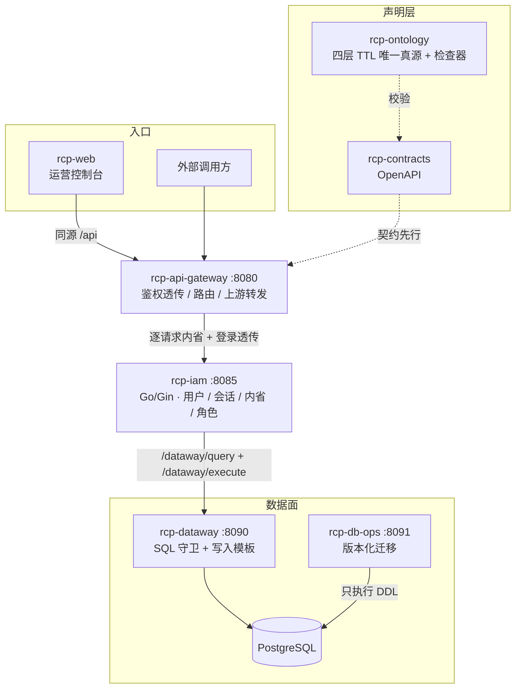

# Risk Control Platform · 架构全景

> 多仓工作区的**统一网关中台**。定位已从「风控巡查平台」转向**统一 API 网关
> （Token 分流）**方向：把多家上游收敛到一个对外入口，做渠道调度、鉴权、用量与配额。
>
> 当前状态：**瘦身后的 8 仓干净骨架**。原四条巡查线与共享基座 `rcp-core` 已移除，
> 服务层清一色 Go。Token 网关的领域模型与契约尚未建立，见文末演进路线。
>
> **定位：架构演示工作区** —— 展示服务拆分、契约治理与部署形态；含 CI 模板，不含真实集群与生产发布。

## 1. 仓清单（8 个）

| 仓 | 角色 | 是什么 |
|---|---|---|
| `rcp-ontology` | 元仓 | 声明层唯一真源（四层 TTL）+ 检查器 |
| `rcp-contracts` | 元仓 | 接口契约（4 份 OpenAPI）+ 对表工具 |
| `rcp-ops` | 元仓 | 迁移真源、K8s/compose 部署清单、构建脚本 |
| `rcp-api-gateway` | 网关 | 对外唯一入口，Go + Gin :8080 |
| `rcp-iam` | 服务 | 平台唯一 IAM，Go + Gin :8085 |
| `rcp-dataway` | 数据网关 | 业务访问数据库的唯一出口，Go + Gin :8090 |
| `rcp-db-ops` | 服务 | 版本化 DDL 的唯一执行者，Go + Gin :8091 |
| `rcp-web` | 前端 | 运营控制台，零构建静态站 :5173 |

## 2. 架构



## 3. 统一契约

**鉴权**（`contracts/openapi/iam.yaml`）：`POST /api/v1/iam/login` 签发不透明 Bearer 令牌，
`POST /api/v1/iam/introspect` 返回 `{active, userId, role, permissions[], expiresAt}`。
除登录外所有 `/api/v1/**` 都要带令牌；令牌形态与权限展开只在 IAM 一处，下游不解析令牌。

**网关当前暴露面**（`contracts/openapi/api-gateway.yaml` v2.0.0）：
只保留 `/api/v1/iam/**` 透传（GET/POST/PUT），鉴权由 IAM 自行完成。
原 `/api/v1/patrol/*` 已随巡查线一并移除；上游转发契约（`/v1/**`）待新方向建模后另行升版。

**鉴权链的真源是 `rcp-iam`**：用户、登录会话、令牌内省与角色权限。网关不解析
令牌、不存角色表——每个受保护请求都调 `/api/v1/iam/introspect` 取 `permissions`，
IAM 不可用时一律拒绝（fail closed）。角色：`ADMIN` / `OPERATOR` / `VIEWER`。

用户与会话经 `dataway` 的 HTTP 契约落 PostgreSQL，不持数据库驱动（RL-005）；
DDL 只在 `rcp-ops/migrations`（RL-004）。

## 4. 数据面分层

| 层 | 仓 | 职责 | 红线 |
|---|---|---|---|
| 数据访问 | `rcp-dataway` | 业务服务访问数据库的唯一出口：SQL 守卫（单条只读 + 表白名单）+ 写入模板；`iam` 经它读写 `iam_users` / `iam_sessions` | RL-005：业务仓不得引入数据库驱动（Go 查 `go.mod`，检查器还兼容 `pom.xml`） |
| 结构变更 | `rcp-db-ops` | 版本化 DDL 的唯一执行者：按序执行、台账、回滚 | RL-004：DDL 只能在 `rcp-ops/migrations` |
| 迁移真源 | `rcp-ops` | `migrations/` 版本化脚本 + K8s 清单 + 本地 compose | — |

## 5. 架构红线（5 条）

| 编号 | 约束 |
|---|---|
| RL-002 | 对外入口只能是网关与前端；其余服务必须 `external=false` |
| RL-004 | DDL 只能出现在 `rcp-ops/migrations` |
| RL-005 | 业务服务不得引入数据库驱动，读写只能经 dataway |
| RL-006 | 服务必须登记并挂契约 |
| RL-007 | 部署清单不得写死内部服务地址 |

红线原为 7 条，RL-001（巡查线互调）与 RL-003（决策语义三方一致）随巡查线一并移除。

## 6. 快速开始

```bash
# 全量构建（契约 → 本体 → 各服务 → 前端 → 部署，任一步红灯即停）
rcp-ops/tools/build_all.sh

# 本地起全平台（含 PostgreSQL，构建上下文指向兄弟仓）
cd rcp-ops && docker compose up --build

# 单个服务
cd rcp-api-gateway && go test ./... && go build ./...

# 前端
cd rcp-web && python -m http.server 5173
```

## 7. 演进路线（Token 分流方向）

- [ ] 领域建模：渠道（channel）/ 令牌（token）/ 分组（group）/ 配额（quota）/ 用量账本（usage）
- [ ] 契约先行：`contracts/openapi/` 新增 OpenAI 兼容 `/v1/**` 与渠道管理接口
- [ ] 网关改造：协议转换 + 多渠道按权重/成本调度 + 429/5xx 故障转移
- [ ] 数据面：渠道与令牌经 dataway 落 PostgreSQL，迁移脚本进 `rcp-ops/migrations`
- [ ] 控制台：渠道管理、令牌签发、用量与成本看板
- [ ] 上游方案：直接部署 new-api（AGPL-3.0）与本仓网关的边界需先定清
