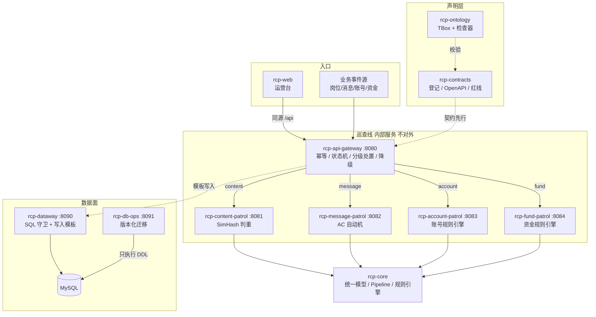

# Risk Control Platform · 架构全景

> 蓝领招聘平台的**统一风控中台**。平台只有一个，巡查只是内部功能；
> 实现上拆为**多仓**：契约仓 + 本体仓 + 基座仓 + 网关 + 四条巡查线 + 数据网关 + 数据库操作服务 + 前端 + 部署。
>
> **定位：架构演示工作区** —— 展示业务建模、服务拆分、契约治理与部署形态；含 CI 模板，但不含真实集群与生产发布。

## 1. 业务全景

平台治理四类业务风险，对应四条内部巡查线：

| 巡查线 | 服务仓 | 风险场景 | 核心技术 | 决策方式 |
|---|---|---|---|---|
| 内容巡查 | `rcp-content-patrol` | 黑中介洗稿岗位、信息流重复 | SimHash + 3-gram + 抽屉原理分段索引 | 双通道判重（正文 SimHash 主通道 + 标题编辑距离兜底） |
| 消息巡查 | `rcp-message-patrol` | 飞单/私单诱导话术 | AC 自动机 + 三步变体归一化 + 角色分级 | 白名单降级 + 招聘侧拦截 / 求职侧提示 |
| 账号巡查 | `rcp-account-patrol` | 接码注册、设备农场养号 | 号段特征 + 设备/IP 聚集 + 行为序列 | 规则引擎（6 条分级规则） |
| 资金巡查 | `rcp-fund-patrol` | 补贴薅取、领补贴团伙 | 放款前后分层 + 设备/银行卡聚集 | 规则引擎（4 条分层规则） |

`rcp-api-gateway` 是所有风险的**唯一入口**，承担共同基建：事件路由、消费幂等（`event_id+version`）、
状态机单调前进、分级处置、巡查线降级（不可用转人工加审，绝不漏审）。

`rcp-core` 是共享基座：统一决策模型（`Decision`/`PatrolVerdict`）、同构 Pipeline 抽象
（归一化 → 特征提取 → 检测 → 决策）、轻量规则引擎（优先级短路 + 不可变快照）。

## 2. 架构



## 3. 统一契约

平台只有一个巡查契约，新增巡查线 = 新增一个服务仓 + 在契约仓登记一行 + 挂一份 OpenAPI：

```
POST /api/v1/patrol/dispatch          # 网关唯一入口
{
  "eventId": "job:123",               # 幂等键
  "domain":  "content",               # 巡查线路由键: content/message/account/fund
  "version": 1,                       # 事件版本（重放拒绝旧版本）
  "payload": { ...巡查线业务字段... }
}
→ { "accepted": true, "verdict": {...}, "disposition": {"action": "BLOCK"}, ... }
```

每条巡查线暴露统一检测接口 `POST /api/v1/patrol/check`（payload 即请求体），返回统一
`PatrolVerdict { eventId, decision, score, reason, detail }`。

**决策枚举（全平台统一）**：`PASS → WARN → LIMIT → EXTRA_REVIEW → INTERCEPT → BAN`
（状态机只允许沿此序单调前进，回跳拒绝）。枚举三处必须逐字一致：`rcp-core` 的 `Decision`、
`rcp-contracts/contracts/schemas/decision.yaml`、`rcp-ontology/concepts/decisions.yaml`（红线 RL-003）。

## 4. 巡查线业务规则速览

**内容巡查**：城市+工种分片前置（跨城市同模板合法）→ SimHash 汉明距离 ≤3 判重 → 标题编辑距离 ≤4 兜底；判重即拦截。

**消息巡查**：符号归一（➕→加/❤→信）→ 干扰符剔除（破解"加.薇.芯"）→ 变体映射（vx/薇芯→微信）→ AC 自动机一次扫描；招聘侧命中拦截、求职侧仅提示、官方话术白名单放行。

**账号巡查**：虚拟号段+设备聚集 → 封禁；同设备 ≥5 账号 → 封禁；同 IP 24h 注册 ≥10 → 拦截；虚拟号段单独命中 → 加审；夜间批量注册 → 加审；24h 发帖 ≥20 → 限流。

**资金巡查**：同银行卡 ≥3 账号 → 封禁（团伙）；同设备 ≥3 账号且金额 ≥500 → 拦截；新号（≤3 天）高额（≥200）→ 加审（放款前分层）；24h 申请 ≥5 → 限流。

## 5. 数据面分层

| 层 | 仓 | 职责 | 红线 |
|---|---|---|---|
| 数据访问 | `rcp-dataway` | 业务服务访问数据库的唯一出口：SQL 守卫（单条只读 + 表白名单）+ 写入模板 | RL-005：业务仓不得引入 JDBC 驱动 |
| 结构变更 | `rcp-db-ops` | 版本化 DDL 的唯一执行者：按序执行、台账、回滚 | RL-004：DDL 只能在 `rcp-ops/migrations` |
| 迁移真源 | `rcp-ops` | `migrations/` 版本化脚本 + K8s 清单 + 本地 compose | — |

## 6. 快速开始

```bash
# 全量构建（契约 → 本体 → 基座 → 各服务 → 前端 → 部署，任一步红灯即停）
rcp-ops/tools/build_all.sh

# 本地起全平台（含 MySQL，构建上下文指向兄弟仓）
cd rcp-ops && docker compose up --build

# 只跑某条巡查线
cd rcp-content-patrol && mvn -B verify

# 前端
cd rcp-web && python -m http.server 5173
```

## 7. 生产化演进路线

- [ ] 幂等/状态机从进程内 Map 落到 MySQL（表结构已备：`rcp-ops/migrations/V1.0.0__common_schema.sql`）
- [ ] 接入层从同步 HTTP 演进为 Kafka 事件总线（网关契约不变，巡查线消费各自 topic）
- [ ] 规则/词库管理端 + 热更新（规则快照原子切换，`patrol_rule` 表已备）
- [ ] 人工复核工作台 + 误杀/漏放标注回流（词库、阈值月度重标定）
- [ ] 巡查指标大盘（桶倾斜/堆积/命中率/误杀率）
- [ ] OpenTelemetry 全链路追踪（eventId 贯穿网关与巡查线）
