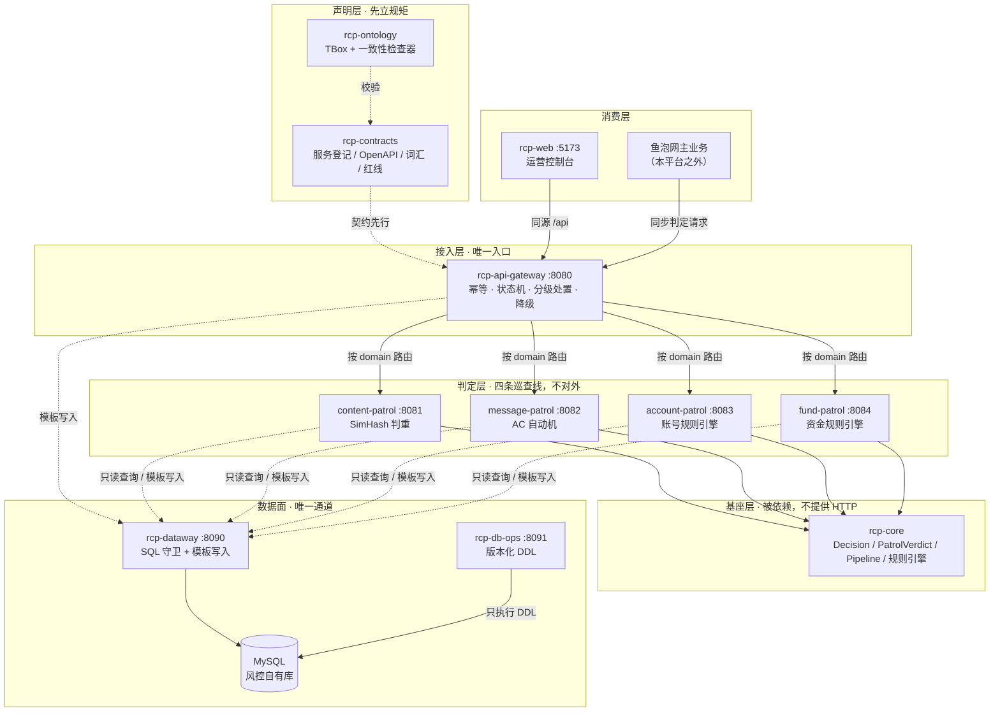
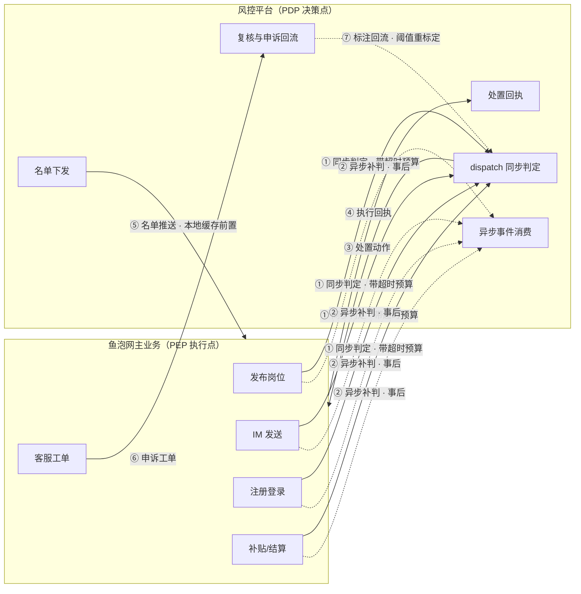

# 风控平台总纲 · 自身架构与鱼泡网主业务关系

> **文档定位**：跨仓总纲。回答两个问题——风控平台自己长什么样，以及它和鱼泡网主业务之间是什么关系、怎么接。
>
> **读者**：主业务侧研发（看第 2、3 章）、风控平台研发（看第 1、2.2、2.5 章）、技术与业务决策者（看第 0、2.1、4 章）。
>
> **事实基准**：`rcp-ontology/ontology/`（`abox/services.ttl`、`policy/redlines.ttl`、`tbox/*.ttl`）、`rcp-contracts/contracts/schemas/*`、`rcp-ops/migrations/*`。凡标注「设计建议」的内容尚未落地，不得当作现状引用。
>
> **边界声明**：本工作区是架构演示工作区，含契约、代码与部署清单，**不含真实集群与生产发布**。文中不声称任何环境已上线。

---

## 0. 一页结论

**一句话**：风控平台不参与业务事务，只在主业务的关键写入时刻提供**决策**，由主业务负责**执行**。这是决策点与执行点分离（PDP / PEP 分离）的旁路中台，不是业务系统的一个模块。

五条设计结论：

| # | 结论 | 含义 |
|---|---|---|
| 1 | **主业务是唯一执行点** | 风控只输出 `Decision` + `reason` + `detail`，拦截/限流/封禁的实际动作、文案、页面全部由主业务实现 |
| 2 | **业务库是唯一真源，风控只读** | 风控不写主业务库、不持有岗位/用户/资金流水的主数据，只保存"裁决、规则、名单、复核"四类自有数据 |
| 3 | **同步判定只设在不可逆写入口** | 发布岗位、发消息、注册、放款前同步判定；列表刷新、统计、检索等读路径不做实时判定，靠"名单前置 + 发布时拦截"覆盖 |
| 4 | **失败语义按域分档，且必须写进契约** | 资金与账号不放过（fail-closed / 转人工加审），内容转待审落库，消息降级放行并异步补判（fail-open） |
| 5 | **跨系统只认契约，不认枚举值** | 主业务不得硬编码 `PASS/LIMIT/BAN` 等取值，只能 `$ref` 契约仓的 `decision.yaml`；字段变更先改契约再改两侧实现 |

关系形态的最终选择是：**以同步决策服务为主干（当前形态），异步事件补判为兜底，演进方向为事件总线 + 特征平台**（见 2.1、第 4 章）。

---

## 1. 平台自身架构

### 1.1 定位

一个**统一风控中台**：平台只有一个，四条巡查线只是内部功能，不对外暴露。风控能力按业务域切分为内容、消息、账号、资金四条线，四条线共享同一套决策语义、同一套接入契约、同一套数据面约束。

### 1.2 分层结构



读图要点：**主业务与运营台是两个不同的入口方**，但共用同一个网关和同一套契约；判定层对二者都不可见，任何一方都无法绕过网关直连巡查线（红线 RL-002）。

### 1.3 服务清单

| 服务 | 种类 | 端口 | 对外 | 职责 |
|---|---|---|---|---|
| `api-gateway` | 网关 | 8080 | 是 | 唯一入口：幂等、状态机、分级处置、降级编排 |
| `content-patrol` | 巡查线 | 8081 | 否 | 岗位内容判重（SimHash + 标题编辑距离兜底） |
| `message-patrol` | 巡查线 | 8082 | 否 | 飞单话术识别（变体归一化 + AC 自动机 + 角色分级） |
| `account-patrol` | 巡查线 | 8083 | 否 | 接码注册、设备农场养号（6 条分级规则） |
| `fund-patrol` | 巡查线 | 8084 | 否 | 补贴薅取、领补贴团伙（4 条分层规则） |
| `dataway` | 数据网关 | 8090 | 否 | 数据访问唯一出口：单条只读 + 表白名单 + 模板写入 |
| `db-ops` | 数据库操作 | 8091 | 否 | 版本化 DDL 唯一执行者：按序执行、台账、回滚 |
| `rcp-core` | 库 | — | — | `Decision`/`PatrolVerdict` 统一模型、Pipeline、规则引擎 |
| `web` | 前端 | 5173 | 是 | 运营控制台，只经网关访问后端 |

### 1.4 五个承重机制

这五个机制是平台能被称为"中台"而非"四个脚本服务"的原因，也是它与主业务对接时不产生额外协调成本的关键。

1. **统一契约**。所有风险判定收敛为一个入口 `POST /api/v1/patrol/dispatch`，请求含 `eventId / domain / version / payload`，响应含 `verdict / disposition`。新增一类风险 = 新增一个服务仓 + 契约仓登记一行 + 挂一份 OpenAPI，主业务侧接入代码形态不变。
2. **消费幂等**。`eventId + version` 为幂等键：同键同版本重放不再产生新裁决，旧版本回放直接拒绝（`STALE_VERSION`）。这让主业务可以安全重试，而不必担心重复判定导致风险分叠加。
3. **状态机单调前进**。决策按 `PASS → WARN → LIMIT → EXTRA_REVIEW → INTERCEPT → BAN` 只升不降，回跳被拦截并置 `stateRollbackProtected=true`。防的是乱序消息把已封禁对象"刷回"通过。
4. **分级处置**。决策等级到落地动作的映射集中一处，业务侧只按动作分支执行，不必理解每条线的评分逻辑。
5. **降级不漏审**。巡查线不可用时不是放行，而是转 `EXTRA_REVIEW`（`reason=PATROL_SERVICE_DEGRADED`）。注意这是**平台默认**语义，各业务域可按 2.6 的矩阵覆盖为降级放行——但覆盖必须显式登记，不能默默改。

### 1.5 四条巡查线的判定口径

| 巡查线 | 风险场景 | 核心技术 | 判定产出 |
|---|---|---|---|
| 内容 | 黑中介洗稿岗位、信息流重复 | 城市+工种分片前置 → SimHash 汉明距离 ≤3 → 标题编辑距离 ≤4 兜底 | 命中 `INTERCEPT`，否则 `PASS` |
| 消息 | 飞单/私单诱导话术 | 符号归一 → 干扰符剔除 → 变体映射 → AC 自动机一次扫描 | 招聘侧命中拦截，求职侧仅提示，官方话术白名单放行 |
| 账号 | 接码注册、设备农场养号 | 号段特征 + 设备/IP 聚集 + 行为序列 | 规则引擎 6 条分级规则 |
| 资金 | 补贴薅取、领补贴团伙 | 放款前后分层 + 设备/银行卡聚集 | 规则引擎 4 条分层规则 |

一条重要的不对称原则：内容判重属"漏放代价 << 误杀代价"，阈值向 precision 倾斜；资金与账号相反，向 recall 倾斜。**这个不对称决定了 2.6 的失败语义必须按域分档，不能全局统一。**

---

## 2. 与鱼泡网主业务的关系（核心）

### 2.1 集成模式选型

风控与业务结合有四种典型形态，取舍如下：

| 模式 | 形态 | 优点 | 代价 | 本项目取舍 |
|---|---|---|---|---|
| A. 嵌入式 SDK | 风控逻辑打成 jar 跑在业务进程内 | 零网络开销，延迟最低 | 规则升级要随业务发版；风控故障即业务故障；四类风险耦合进业务代码；无法独立扩缩容 | **不采用** |
| B. 同步决策服务 | 业务在写操作前 RPC 调风控，按返回动作执行 | 责任清晰、可独立发布与扩缩容、多业务方复用 | 引入同步依赖，需设计超时与降级 | **主干（当前形态）** |
| C. 异步事后巡查 | 业务先落库，事件投递后离线判定，命中再撤回 | 对主流程零侵入、零延迟 | 止血慢，违规内容有曝光窗口；撤回补偿逻辑复杂 | **兜底（离线全量巡检）** |
| D. 事件总线流式 | 业务发事件到 Kafka，风控流式消费 | 削峰、可回放、天然解耦 | 判定结果回传链路长；一致性与时效需额外设计 | **演进方向** |

**结论**：以 B 为主干，C 补覆盖 B 挡不住的存量与漏网，D 作为规模化后的目标形态。不采用 A 的核心理由不是性能，而是**发布耦合与责任边界**——风控规则迭代频率远高于业务，绑在一起会让每次阈值调整都变成业务发版。

当前工作区实现的正是 B（同步 dispatch）。表结构里已预留 Kafka topic 规划（`patrol.content.publish` / `patrol.im.message` / `patrol.account.register` / `patrol.fund.grant`），但总线尚未落地，属演进项。

### 2.2 边界契约：三个"不"

关系的清晰度取决于边界的可执行性。以下三条是硬边界，违反即视为架构偏离。

1. **不写业务库**。风控对主业务数据只有读权限，且只读经 `dataway` 的声明式查询（红线 RL-005）。风控不拥有岗位、用户、消息、资金流水的主数据。
2. **不持有业务状态机**。风控的 `patrol_object_state` 是"巡查对象状态"（待审/通过/疑似/拦截/封禁/申诉中），**不是**"岗位状态"或"订单状态"。业务对象如何流转由业务决定，风控只提供决策输入。
3. **不执行用户可见动作**。拦截文案、限流提示、封禁页面、申诉入口全部由主业务实现。风控给出 `action` 建议并记录，实际呈现归业务。

反过来，主业务侧也有两条对等义务：

- **不绕过网关**：不得直连巡查线端口，也不得复制风控的判定逻辑到业务侧做"预判"（会导致两套阈值）。
- **不回写风控库**：执行结果通过回执接口提交，不直连 `dataway` 写风控表。

### 2.3 五个交互面

关系不是一条 RPC，而是五个方向不同的交互面。设计时逐面定义契约，才不会在联调期反复拉扯。



| # | 交互面 | 方向 | 同步/异步 | 契约载体 | 状态 |
|---|---|---|---|---|---|
| ① | 实时判定 | 业务 → 风控 | 同步 | `POST /api/v1/patrol/dispatch` | 已实现 |
| ② | 异步补判 | 业务 → 风控 | 异步（事件） | Kafka topic 规划已备 | **未实现** |
| ③ | 处置动作返回 | 风控 → 业务 | 同步响应体内 | `disposition` | 已实现 |
| ④ | 执行回执 | 业务 → 风控 | 异步 | 缺契约，落 `patrol_action_log` | **待补** |
| ⑤ | 名单下发 | 风控 → 业务 | 推送 + 拉取 | 缺契约 | **待补** |
| ⑥ | 复核申诉 | 业务客服 → 风控 | 异步 | 复用 `patrol_review_queue` | 表已备，接口待补 |
| ⑦ | 标注回流 | 风控内部闭环 | — | `patrol_feedback` | 表已备 |

**④ 是最容易被忽略但必须补的一环**：没有回执，风控只知道自己"建议了什么"，不知道"实际发生了什么"。拦截生效数、误杀率、处置失败率这三个核心指标全部无法成立。这也是当前架构最实质的缺口。

**⑤ 是降低同步依赖的关键**：把 `BAN`/`INTERCEPT` 的对象下发到业务侧本地缓存（TTL 5 分钟 + 变更推送），业务在读路径上直接过滤，不必每次都同步调用风控。设计上可覆盖绝大多数重复访问，把同步调用量压到"真正的首次写入"。

### 2.4 场景映射：鱼泡网业务动作 → 风控交互

这是双方对接时唯一需要逐行确认的表。**是否阻塞**列是产品决策，不是技术决策，需要业务侧共同签署。

| 业务动作 | eventId 形态 | domain | 触发时机 | 阻塞主流程 | 风控不可用时 |
|---|---|---|---|---|---|
| 发布/编辑岗位 | `job:{jobId}` | content | 入库前 | **是** | 以"待审核"状态落库，不进入公开列表 |
| 岗位列表/搜索/详情 | — | — | 不调用 | 否 | 靠名单前置过滤 + 发布时已拦截 |
| IM 发送（招聘方） | `msg:{msgId}` | message | 送达前 | **是** | 降级放行 + 异步补判 + 事后撤回 |
| IM 发送（求职方） | `msg:{msgId}` | message | 送达前 | 否（仅提示） | 直接放行 |
| 注册 / 登录 / 换绑手机 | `acc:{userId}` | account | 账号生效前 | **是** | 拒绝并提示稍后重试（不放行） |
| 补贴申请 / 提现 / 工资结算 | `fund:{bizId}` | fund | 放款指令前 | **是** | 转人工加审，钱不出账 |
| 存量全量巡检 | `batch:{date}` | 各域 | T+1 离线 | 否 | 顺延至次日 |

两条工程约束需要注意，它们会影响业务侧的表设计：

1. **eventId 用业务主键，意味着 ID 必须预先生成**。`job:123` 里的 `123` 要能作为幂等键，业务侧需在写库前拿到 ID（雪花 ID 或号段预分配）。若业务用数据库自增 ID，只能在插入后拿到——此时判定发生在落库之后，业务侧必须有"待审"状态承接而非直接公开。**推荐前者**：预生成 ID + 入库前判定，语义最干净。
2. **version 是业务对象的版本号，不是每次随机递增**。岗位内容每变更一次 `version+1`，风控据此拒绝旧版本重放。若业务侧传固定 `1`，重放保护形同虚设。

### 2.5 数据边界：谁拥有什么

| 数据 | 归属 | 风控权限 | 说明 |
|---|---|---|---|
| 岗位内容、用户资料、IM 消息、资金流水 | **主业务** | 只读（经 dataway 声明式查询） | 风控不持有副本，不做二次主数据 |
| 巡查事件台账 `patrol_event` | 风控 | 读写 | 排障用原始载荷快照，保留期由业务合规决定 |
| 巡查裁决台账 `patrol_verdict` | 风控 | 读写 | 含 `decision / score / reason / degraded` |
| 巡查对象状态 `patrol_object_state` | 风控 | 读写 | 单调状态机，防乱序回跳 |
| 规则 `patrol_rule` | 风控 | 读写 | 条件树 + 优先级，支持快照原子切换 |
| 处置流水 `patrol_action_log` | 风控 | 读写 | 含执行回执，`operator` 区分 SYSTEM / 人审 |
| 复核队列 `patrol_review_queue` | 风控 | 读写 | 人审唯一入口 |
| 标注回流 `patrol_feedback` | 风控 | 读写 | 误杀/漏放样本，驱动阈值重标定 |

**特征获取的两条路径**，按优先级使用：

1. **内联（首选）**：`payload` 里由业务侧提供判定所需字段（如内容巡查的 `jobId/city/trade/title/body`）。优点是无额外往返，缺点是字段集变更需改契约。
2. **反查（兜底）**：需要业务侧未内联的特征（如设备历史、账号注册时长、同卡关联）时，经 `dataway` 声明白名单视图查询。缺点是多一次往返，占用同步预算。

设计取向：**能内联就内联**。同步判定路径上的反查次数应受严格限制（建议 ≤1 次），否则超时预算无法收敛。

### 2.6 故障语义矩阵

同一套风控，不同业务域对"漏放"和"误杀"的容忍度完全不同，因此失败语义必须分域定义，并且**登记进契约**，不允许各线自行决定。

| 域 | 漏放代价 | 误杀代价 | 风控不可用/超时策略 | 理由 |
|---|---|---|---|---|
| account | 极高（黑产账号进入即污染全平台） | 中（用户可申诉重试） | **fail-closed**：拒绝，提示稍后重试 | 注册失败可重来，黑产账号进入后清理成本远高 |
| fund | 极高（真金白银出账） | 中（延迟放款可解释） | **fail-closed**：转 `EXTRA_REVIEW`，钱不出账 | 资金损失不可逆，延迟可接受 |
| content | 中（洗稿岗位曝光影响体验） | 中（岗位作者会投诉） | **待审落库**：不阻塞提交，但不得公开展示 | 让业务状态机承接不确定性，而非让用户看到报错 |
| message | 低（单条消息可事后撤回） | 高（IM 不可用直接影响核心体验） | **fail-open + 异步补判** | 聊天中断的用户感知远强于单条话术漏放 |

注意 content 一档的做法：**用"状态"而不是"异常"表达不确定性**。业务侧把岗位存成"待审核"，用户看到的是"审核中"而非"系统错误"，风控恢复后补判再决定是否公开。这比直接报错或直接放行都更符合产品语义。

### 2.7 延迟与超时预算（设计目标，未压测标定）

主业务写接口 P99 总预算按 300ms 规划，风控同步调用占其中 **≤120ms**：

| 环节 | 预算 | 超时后行为 |
|---|---|---|
| 主业务本地准备（序列化、特征拼装） | ≤20ms | — |
| 网络往返（含连接复用） | ≤20ms | — |
| 网关自身开销（幂等查、状态机、路由） | ≤20ms | — |
| 巡查线判定 | ≤60ms | 超时即按 2.6 降级 |
| **主业务侧总超时** | **120ms** | 触发该域降级策略，并记录 `degraded` |

三个配套要求：

- **连接池与超时必须显式配置**，禁止使用框架默认无限等待。
- **判定必须无阻塞 IO**：规则读内存快照，不查库；确需查库的一律走异步预热。
- **降级要可观测**：`degraded=1` 的裁决必须打点，否则降级长期挂着无人发现。

以上为主观设计目标，需在真实业务 QPS 下压测后标定；当前工作区不具备压测条件，不予声称。

### 2.8 变更与治理流程

风控与业务是两个发布节奏不同的系统，跨系统变更必须走固定顺序，否则会出现"业务已上线、风控还没认这个字段"的错位。

**契约先行四步**（顺序不可颠倒，反了 `ontology check` 与 `contract_check` 会红）：

```
1. rcp-contracts  登记 / 词汇立名 / 改 OpenAPI 或 schema
2. rcp-ontology   若涉及新种类、新能力，补 TBox 概念
3. 实现仓          改代码，抬钉同步 rcp-core 版本
4. 主业务侧        按新契约接入或调整
```

**主业务接入 checklist**：

- [ ] `eventId` 采用规范前缀（`job:` / `msg:` / `acc:` / `fund:`）+ 业务主键，且主键在写库前可得
- [ ] `version` 传业务对象真实版本号，内容变更即递增
- [ ] `domain` 取值来自契约枚举，不硬编码字符串散落各处
- [ ] 决策分支用 `switch` 覆盖全部 6 个等级，含 `default` 走该域降级策略（不得静默放行）
- [ ] 超时与重试显式配置，重试只对幂等安全的错误码进行
- [ ] 落库时保存 `eventId + decision + reason`，用于事后回溯与申诉举证
- [ ] 执行结果通过回执接口上报（接口待补，见 2.3 ④）

---

## 3. 主业务侧接入规范

### 3.1 同步判定调用

```http
POST /api/v1/patrol/dispatch
Content-Type: application/json

{
  "eventId": "job:8817263940123",
  "domain":  "content",
  "version": 1,
  "payload": {
    "jobId": 8817263940123,
    "city":  "杭州",
    "trade": "装修",
    "title": "招瓦工日结300",
    "body":  "..."
  }
}
```

```json
{
  "accepted": true,
  "verdict": {
    "eventId": "job:8817263940123",
    "decision": "INTERCEPT",
    "score": 80,
    "reason": "SIMHASH_DUPLICATE",
    "detail": { "similarJobId": 8817263940001, "hamming": 2 }
  },
  "disposition": { "action": "BLOCK", "target": "job" },
  "stateRollbackProtected": false
}
```

### 3.2 执行点写法（PEP）

业务侧的执行逻辑应保持"薄"——只做动作映射，不含判定逻辑：

```java
// 业务侧伪代码：判定与执行严格分离
Verdict v = riskClient.dispatch(event);          // 超时按域降级，见 2.6

switch (v.getDecision()) {
    case PASS          -> publish(job);
    case WARN          -> { publish(job); notifyAuthor(job, v.getReason()); }
    case LIMIT         -> { publishWithRateLimit(job); }
    case EXTRA_REVIEW  -> saveAsPending(job);     // 待审落库，不公开
    case INTERCEPT     -> reject(job, v.getReason());
    case BAN           -> { reject(job, v.getReason()); banAccount(job.getUserId()); }
    default            -> degradeByDomain(v);     // 不得静默放行
}

// 必须落库，用于回溯、申诉举证与效果统计
auditLog.save(event.getEventId(), v.getDecision(), v.getReason());
```

两条实现纪律：

1. **`default` 分支必须存在且明确**。新增决策等级时，未升级的业务侧应走保守路径而非静默放行。
2. **判定结果必须持久化到业务侧**。风控的台账只能证明"给过什么结论"，无法证明"业务是否照做"；申诉时需要业务侧自己的记录。

### 3.3 禁止事项

| 禁止 | 后果 |
|---|---|
| 业务侧复制风控阈值做本地预判 | 两套阈值必然漂移，误杀归因不清 |
| 调用失败后直接放行且不记录 | 降级不可观测，风控长期失效无人知晓 |
| 把风控 `eventId` 当作业务主键使用 | 两套 ID 语义混用，溯源与对账都做不了 |
| 在业务事务内同步等待风控且无超时 | 风控抖动直接放大为业务雪崩 |

---

## 4. 演进路线

| 阶段 | 形态 | 解决的问题 | 前置条件 |
|---|---|---|---|
| **一（当前）** | 同步 RPC 判定 + 进程内幂等/状态机 | 建立统一入口与统一决策语义 | — |
| **二** | 幂等/状态机落 MySQL + 名单下发 + 处置回执 + 复核工作台 | 单点重启不丢状态；指标可算；误杀可申诉 | 补 ⑤④ 两个契约 |
| **三** | Kafka 事件总线 + 异步补判 + 特征平台 | 削峰、可回放；同步路径不再依赖反查 | topic 规划已备，需接入 |
| **四** | 规则管理端 + 热更新 + 指标大盘 + 全链路追踪 | 阈值可运营；`eventId` 贯穿排查 | 规则快照原子切换能力 |

阶段二里的**处置回执与名单下发是最优先项**——它们直接决定这套系统能否被证明有效，而不仅是"跑起来了"。

---

## 5. 未覆盖与已知偏离

诚实清单，供评审时对照，不作美化：

| 项 | 状态 | 影响 |
|---|---|---|
| 服务注册中心 | **缺失（唯一硬偏离）** | 网关路由由配置给出、K8s 用 Service DNS 覆盖，与"不写死上游地址"原则不符，需在 `policy/redlines.ttl` 登记例外或后续接入服务发现 |
| 幂等与状态机存储 | 进程内 Map | 网关重启丢状态，重放保护失效；表结构已备（`patrol_idempotent` / `patrol_object_state`） |
| 处置回执接口 | 未实现 | 处置生效数、误杀率不可算 |
| 名单下发/订阅 | 未实现 | 读路径只能实时判或完全不判，同步依赖偏重 |
| 异步补判链路 | 未实现 | 消息域 fail-open 后无补偿判定，漏放不可回收 |
| 特征平台 | 不存在 | 跨账号/跨设备特征只能临时反查，同步预算难收敛 |
| 申诉工单 | 表已备、接口未做 | 误杀用户无正式通道 |
| 指标大盘 | 不存在 | 命中率、误杀率、降级率均无观测 |
| 生产环境 | 无 | 本文所有延迟与容量数字均为设计目标，非实测 |

---

## 附录 A · 术语

| 术语 | 定义 | 所有者 |
|---|---|---|
| 巡查事件 patrol_event | 进入平台统一入口的一次业务事实，以 `event_id + version` 唯一标识 | platform |
| 巡查线 patrol_line | 按业务域切分的判定单元：content / message / account / fund | platform |
| 巡查结论 patrol_verdict | 单条巡查线对事件的统一结论，含决策、风险分、原因、明细 | rcp-core |
| 决策 decision | 处置等级枚举，唯一真源为 `rcp-ontology/ontology/tbox/decisions.ttl` | rcp-ontology |
| 分级处置 disposition | 由网关按决策等级映射出的执行动作 | api-gateway |
| 幂等键 idempotency_key | `event_id + version`；同键重放不产生新裁决，旧版本被拒绝 | api-gateway |
| PDP / PEP | 决策点 / 执行点。本平台是 PDP，主业务是 PEP | 本文引入 |
| 待审落库 | 用业务状态表达判定不确定性，而非用异常 | 本文引入 |

> 新增术语须先在 `rcp-ontology/ontology/tbox/terms.ttl` 立名，再进入契约与实现；同一概念禁止多套叫法。
