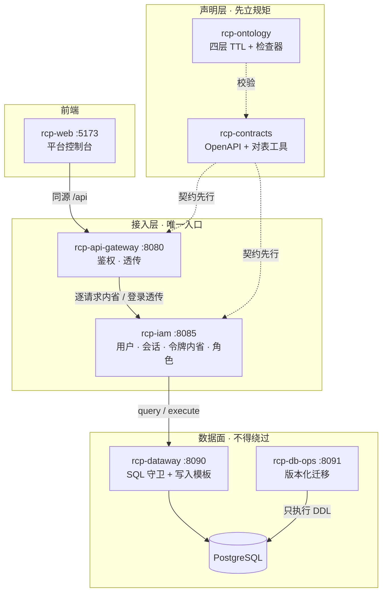

# 平台总纲 · 8 仓骨架与 Token 分流方向

> **文档定位**：跨仓总纲。回答两个问题——平台自己长什么样，以及它接下来的方向是什么。
>
> **读者**：平台研发（第 1、2 章）、技术与决策者（第 0、4 章）。
>
> **事实基准**：`rcp-ontology/ontology/` 四层 TTL（`tbox/*.ttl`、`abox/*.ttl`、`policy/redlines.ttl`、`shapes/core.ttl`）
> 是声明层唯一真源；`rcp-contracts/contracts/*` 是接口契约；`rcp-ops/migrations/*` 是 DDL 真源。
> 凡标注「设计建议」的内容尚未落地，不得当作现状引用。
>
> **边界声明**：本工作区是架构演示工作区，含契约、代码与部署清单，**不含真实集群与生产发布**。

---

## 0. 一页结论

**一句话**：平台正在从"风控巡查中台"转向"**Token 分流网关**"——把多家上游模型收敛到一个对外入口，
做渠道调度、鉴权、配额与用量记账。当前处于**瘦身后的干净骨架**状态：旧业务已清空，新业务尚未建模。

四条结论：

| # | 结论 | 含义 |
|---|---|---|
| 1 | **先瘦身，再长业务** | 四条巡查线与共享基座 `rcp-core` 已下线，本体、契约、部署清单、服务代码里的相关声明一并清除；骨架保持 0 错误 0 提示 |
| 2 | **服务层清一色 Go** | 8 个仓里没有任何 Java 服务；api-gateway / iam 用 Go 1.22，dataway / db-ops 用 Go 1.25 |
| 3 | **声明先于实现** | 新增服务、能力、依赖边都要先改 `rcp-ontology`，再由检查器机械验证；契约对表由 `rcp-contracts/tools` 兜住 |
| 4 | **Token 分流直接采用成熟实现** | 不在本仓自研网关内核；以 new-api（AGPL-3.0）为上游实现，本工作区负责接入、契约与治理 |

---

## 1. 平台自身架构

### 1.1 仓清单（8 个）

| 仓 | 角色 | 是什么 |
|---|---|---|
| `rcp-ontology` | 元仓 | 声明层唯一真源（四层 TTL）+ 检查器 |
| `rcp-contracts` | 元仓 | 接口契约（4 份 OpenAPI）+ 对表工具 |
| `rcp-ops` | 元仓 | 迁移真源、K8s/compose 部署清单、构建脚本 |
| `rcp-api-gateway` | 网关 | 对外唯一入口，Go + Gin :8080 |
| `rcp-iam` | 服务 | 平台唯一 IAM，Go + Gin :8085 |
| `rcp-dataway` | 数据网关 | 业务访问数据库的唯一出口，Go + Gin :8090 |
| `rcp-db-ops` | 服务 | 版本化 DDL 的唯一执行者，Go + Gin :8091 |
| `rcp-web` | 前端 | 平台控制台，零构建静态站 :5173 |

### 1.2 分层结构



### 1.3 鉴权

令牌由 `rcp-iam` 签发，是不透明 Bearer 字符串。网关对每个受保护请求调
`POST /api/v1/iam/introspect` 取 `{active, userId, role, permissions[]}`，
**令牌形态与权限展开只在 IAM 一处**，网关与其他服务都不解析令牌。

- 令牌无效 → `401`；IAM 不可达 → `503`（**fail closed**，不存在"判不了就放行"）。
- `/api/v1/iam/**` 由 IAM 自行校验，网关只透传，不改写 401/403/409 语义。
- 角色：`ADMIN` → `iam:users` + `iam:auth`；`OPERATOR` → `iam:auth`；`VIEWER` → 无。

### 1.4 数据面

| 层 | 仓 | 职责 | 红线 |
|---|---|---|---|
| 数据访问 | `rcp-dataway` | 业务服务访问数据库的唯一出口：SQL 守卫（单条只读 + 表白名单）+ 写入模板 | RL-005 |
| 结构变更 | `rcp-db-ops` | 版本化 DDL 的唯一执行者：按序执行、台账、回滚 | RL-004 |
| 迁移真源 | `rcp-ops` | `migrations/` 版本化脚本 + K8s 清单 + 本地 compose | — |

当前迁移只剩 `V1.4.0__iam_store.sql` / `U1.4.0__iam_store.sql`（`iam_users` / `iam_sessions`）。
1.0.0~1.3.0 随巡查线一并下线；**版本号不回收**，跳过是历史事实。

### 1.5 架构红线（5 条）

| 编号 | 约束 |
|---|---|
| RL-002 | 对外入口只能是网关与前端；其余服务必须 `external=false` |
| RL-004 | DDL 只能出现在 `rcp-ops/migrations` |
| RL-005 | 业务服务不得引入数据库驱动，读写只能经 dataway |
| RL-006 | 服务必须登记并挂契约 |
| RL-007 | 部署清单不得写死内部服务地址 |

原 RL-001（巡查线互调禁令）与 RL-003（决策语义三方一致）随业务下线一并移除。

---

## 2. 与上游的关系（现状）

平台对外只暴露两条面：

1. **`/api/v1/iam/**`** —— 身份面：登录、登出、内省、当前用户、用户与角色管理。
2. **`/actuator/health`** —— 探活（非契约路由）。

原 `/api/v1/patrol/*`（统一巡查入口与平台自描述）已随四条巡查线移除。
Token 网关所需的 `/v1/**` 上游转发面尚未建模——它属于第 4 章的演进项。

---

## 3. 数据与状态

平台自有数据只有 IAM 一份：`iam_users`（用户与角色）、`iam_sessions`（不透明令牌与会话）。
业务数据、模型调用用量、配额账本等 Token 分流所需的数据表**尚未建立**。

---

## 4. 演进路线：转向 Token 分流

### 4.1 已完成的瘦身（本轮）

- 删除 5 个仓：`rcp-account-patrol` / `rcp-content-patrol` / `rcp-fund-patrol` / `rcp-message-patrol` / `rcp-core`；
- 本体层：删 `tbox/decisions.ttl`、`PatrolLine` 类、决策相关 term 与能力，`schema.ttl` 升 3.0.0；
- 契约层：删 4 份巡查 OpenAPI 与决策/事件/裁决 schema，网关切 `api-gateway.yaml` 2.0.0；
- 部署层：删 4 条巡查清单、Nacos 清单与 compose 服务、4 个版本的迁移脚本；
- 服务层：删网关 `internal/patrol`、`internal/model` 与 dispatch 路由，控制台改为会话/用户视图。

### 4.2 下一步（设计建议，未落地）

| 步骤 | 内容 | 落点 |
|---|---|---|
| ① | 引入 new-api 作为 Token 分流内核（AGPL-3.0，保留作者署名与项目链接） | `rcp-ops` 部署清单 + 独立部署仓 |
| ② | 建模新领域：channel / token / group / quota / usage / ratio | `rcp-ontology` 新增 tbox 与 abox 登记 |
| ③ | 立 `/v1/**` 上游转发契约（OpenAI / Claude / Gemini 协议互转） | `rcp-contracts` 新增 OpenAPI，网关升版 |
| ④ | 用量与配额落库（账本表、渠道倍率表） | `rcp-ops/migrations` 新增版本 + `dataway` 白名单 |
| ⑤ | 控制台补渠道 / 令牌 / 用量视图 | `rcp-web` |

new-api 是 AGPL-3.0（含第 7 节附加条款）：分发或对外提供服务时必须保留原作者署名与项目链接，
改造后的源码同样受该协议约束。这一点在决策引入前必须写进仓级 AGENTS。

---

## 5. 验收

```bash
# 声明层 + 契约 + 红线 + 仓布局
python rcp-ontology/checker/cli.py check --ontology rcp-ontology --contracts rcp-contracts -w . --require-workspace

# 契约层
python rcp-contracts/tools/contract_lint.py --contracts rcp-contracts --baseline origin/main

# 服务层（Go）
(cd rcp-api-gateway && go vet ./... && go test ./...)   # 其余服务同理

# 迁移配对
python rcp-ops/tools/check_migrations.py --migrations rcp-ops/migrations
```

预期：检查器 **0 错误 0 提示**；契约仓与本体仓单测全绿；迁移正反向配对完整。
